# 贾维喵管家

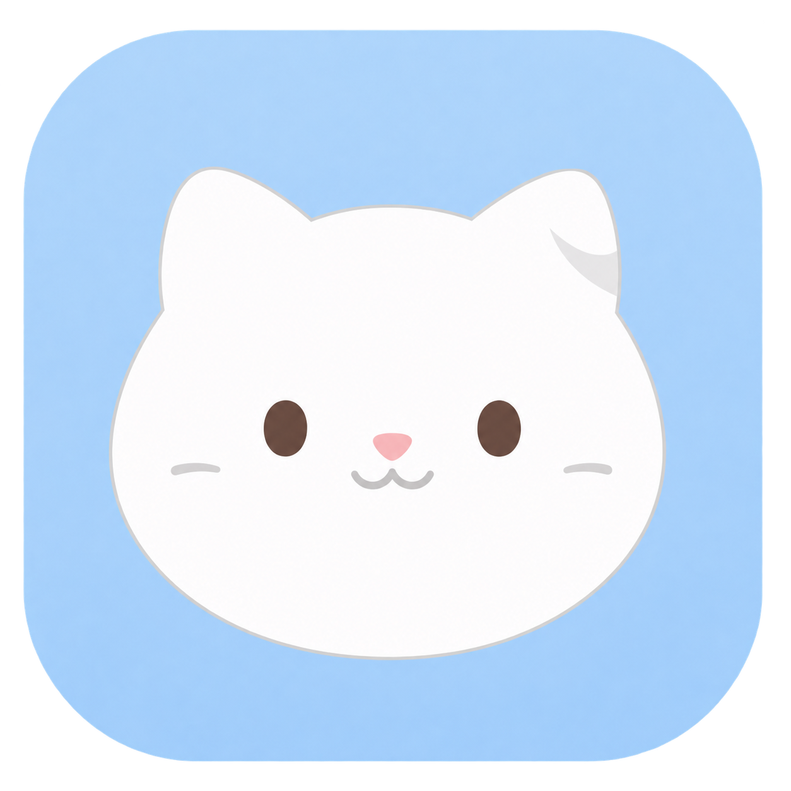

**把随手记录、AI 会话和每天的学习回顾，放进一个本地桌面工作台。**

保留 [Dingmi](https://github.com/qingzo/dingmi) 的主面板、快捷记录与主题，融合 Jarvis Butler 的知识管理能力。一个窗口写笔记、看待办，在右侧与 AI 对话；把重要会话归档，第二天继续复习。

[下载 Windows／Mac 测试版](https://github.com/aiyinsitan520/jarvis-butler-desktop/releases/tag/v0.4.2-preview.2) · [完整中文使用指南](docs/usage.zh-CN.md) · [功能与用法](#功能与用法) · [实际界面图库](#实际界面图库) · [来源与许可](#来源与许可)

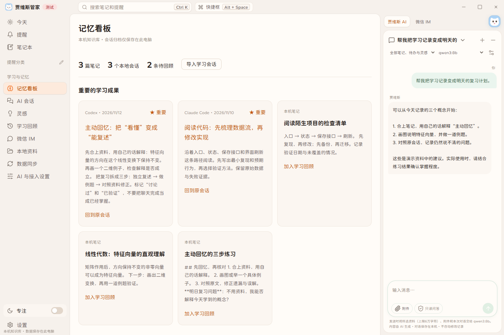

*实际运行的项目界面，内容为合成演示资料。上图来自构建后的前端与隔离 Rust 数据桥；图库另含 Windows 原生窗口截图。AI 回答、模型目录及回顾为示例，微信保持未绑定，不是实际服务验收证明。详见[截图来源](docs/screenshots/README.md)。*

## 适合用来做什么

- **随手留住一个想法**：快捷键呼出输入框，确认保存为笔记或提醒。
- **和 AI 学完后留下可读记录**：归档会话、标记重要、整理成笔记，并保留原文来源。
- **第二天记得回来复习**：查看每日成果、待验证问题，以及按间隔安排的复习卡片。
- **让其他 AI 继续读取资料**：把笔记、会话与回顾保存为 Markdown 和索引，支持现有笔记的外部编辑。
- **按需接入自己的服务**：配置自己的 OpenAI 兼容接口或 Ollama；微信与服务器同步分别启用。

## 下载与快速开始

| 平台 | 安装包 | 状态 |
| --- | --- | --- |
| Windows x64 | [下载 EXE](https://github.com/aiyinsitan520/jarvis-butler-desktop/releases/download/v0.4.2-preview.2/JarvisButler-0.4.2-Windows-x64-setup.exe) | 构建与自动化测试通过；0.4.1安装／重装保留资料已验证，0.4.2安装流程未重测 |
| Mac Apple Silicon（M1／M2／M3 等） | [下载 DMG](https://github.com/aiyinsitan520/jarvis-butler-desktop/releases/download/v0.4.2-preview.2/JarvisButler-0.4.2-macOS-AppleSilicon.dmg) | 构建与自动化测试通过；真机体验待验收，未公证 |

Windows 安装后从开始菜单打开；Mac 把应用从 DMG 拖入 Applications。当前均为测试包，Windows 无商业代码签名，Mac 使用 ad-hoc 签名；按系统正常的安全审批流程决定是否打开，不关闭系统保护。Intel Mac 暂无本版安装包。

第一次使用建议按下面的顺序：

1. **先写一条笔记**：点击“笔记本”，或使用顶部“快捷框”。不需要先配 AI 或服务器。
2. **配置模型**：AI 与接入设置 → 填接口地址和 Key → 一键拉取 → 搜索并点击模型 → 保存。
3. **导入学习会话**：AI 会话 → 导入会话，选择 ChatGPT／Claude 官方导出的支持文件或 Markdown／TXT。
4. **启用每日回顾**：学习回顾中开启提醒；如需自动模型整理，再到本地资料中开启对应开关。
5. **选择长期资料位置**：本地资料 → 先备份 → 迁移到其他文件夹，选择空目录。

更详细的按钮顺序、输入示例、备份恢复和故障处理见[完整中文指南](docs/usage.zh-CN.md)。

## 功能与用法

| 功能 | 能做什么 | 从哪里开始 |
| --- | --- | --- |
| 快捷记录 | 呼出输入框，确认记录为笔记或提醒；保留 Dingmi 的快捷交互 | 顶部“快捷框”；Windows 默认 `Alt+Space` |
| 笔记、提醒与灵感 | 编辑长期笔记、管理到期／完成状态、记录零散想法 | 左侧“笔记本／提醒／灵感” |
| 同页 AI 助手 | 按所选资料范围讨论，保存本机对话，可切换已勾选模型 | 右侧“贾维喵 AI” |
| 模型拉取与选择 | 用当前填写的配置获取模型，搜索、点击设为默认，勾选侧栏可选 | AI 与接入设置 |
| 多 AI 会话归档 | 手动导入、搜索原文、标记重要、回到原会话、继续讨论 | 左侧“AI 会话” |
| 本地会话自动采集 | 授权读取 Codex／Claude Code／Gemini CLI 的日志目录，增量归档 | 本地资料 → 自动采集 AI 会话 |
| 每日成果与间隔复习 | 查看摘要、来源和复习问题，按 1／3／7／14／30 天回顾 | 学习回顾；模型整理在本地资料单独开启 |
| 可迁移本地资料库 | 选择位置、备份恢复、Markdown 双向修改和冲突处理 | 左侧“本地资料” |
| 自建服务器同步 | 预览、确认合并、版本冲突与回执恢复 | 独立的“数据同步”页；需兼容服务 |
| 微信 IM | 本人私聊入口，原文先保存，再按配置整理；可请求已有回顾 | AI 与接入设置 → 本人扫码与配对；真实链路待验收 |

### 快捷记录

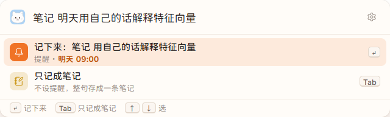

Windows 默认 `Alt+Space` 打开快捷框、`Ctrl+Alt+N` 打开快速笔记。Mac 配置默认 `Option+Space`、`Command+Option+N`，仍需真机核验。占用时提示并允许修改，以页面显示的实际快捷键为准。

含时间的文字可能被识别为提醒；只想留文字时选择“只记成笔记”，先看候选再提交。

### 模型选择与 AI 对话

一键拉取不要求先填写默认模型，也不必先保存。**点击模型名称设为默认 → 勾选其他“侧栏可选”模型 → 保存模型**；之后可在右侧助手切换。OpenAI 兼容、反代、Ollama 都支持这一流程。

本机 Ollama 常用地址为 `http://127.0.0.1:11434`。模型目录不等于推理权限；不提供目录的接口也可手动填写准确 ID。拉取只读模型目录，不会提交笔记或调用推理。

### 会话留存与每日回顾

ChatGPT／Claude 网页版通过官方导出文件导入；本地 CLI 工具在授权日志目录后自动采集。程序不读取浏览器登录态，也不承诺实时自动读取所有网页账号。

给重要会话点亮星标，从“回到原会话”核对来源，或显式请求整理为笔记。每日回顾可使用所选模型提取重点与问题；未开启时保留摘录。练习和复述结果由本人确认，不把“聊过”自动标成“已经掌握”。

后台需要电脑开机、托盘／菜单栏进程运行；关机或退出时暂停，下次启动补处理。微信推送另行启用，结果未知会显示状态，不假报送达。

### 本地文件与其他 AI

迁移后的资料库提供 `notes/`、`todos/`、`inspirations/`、`conversations/`、`reviews/`、附件和 `index.json`。其他 AI 可以先读 README 与索引，再按需读取 Markdown。

编辑现有笔记时保留 `id`、`table`、`base` 元数据；文件改名继续关联原记录，删除先确认，同时修改保留冲突稿。新记录先在应用中创建。自己的回顾心得写到 `.notes.md`，不要改内部 `.jarvis/` 数据库。[目录与冲突处理说明](docs/portable-knowledge.md)。

运行中的 SQLite 不支持用网盘在多设备直接同步；网盘可保存备份副本。

## 实际界面图库

新图标：白色小猫。前端与 Windows 原生截图均已更新为0.4.2白猫版。

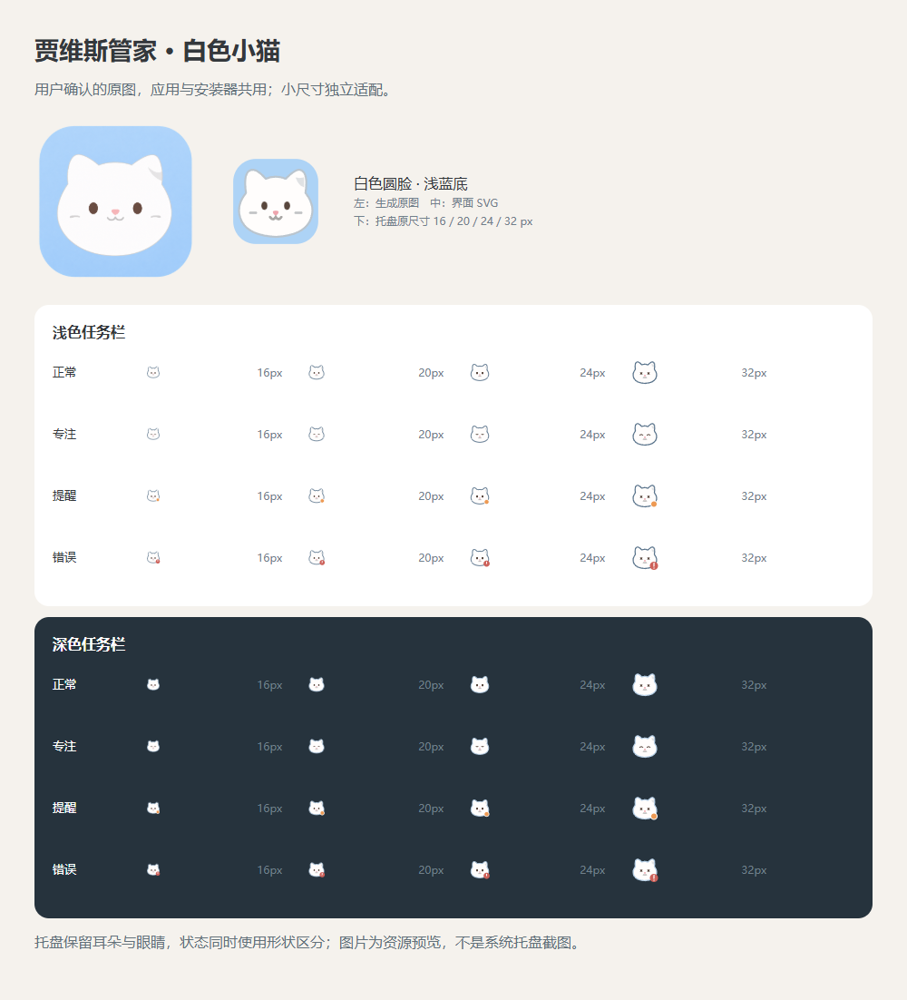

点击图片可查看原图。以下页面来自构建后的实际前端，以隔离 Rust SQLite 和合成资料驱动；模型／网络与原生对话框使用演示适配。不是 Figma 设计稿，也不是 Mac 真机或真实微信送达截图。

| 模型选择 | 会话原文与来源 |
| --- | --- |
| [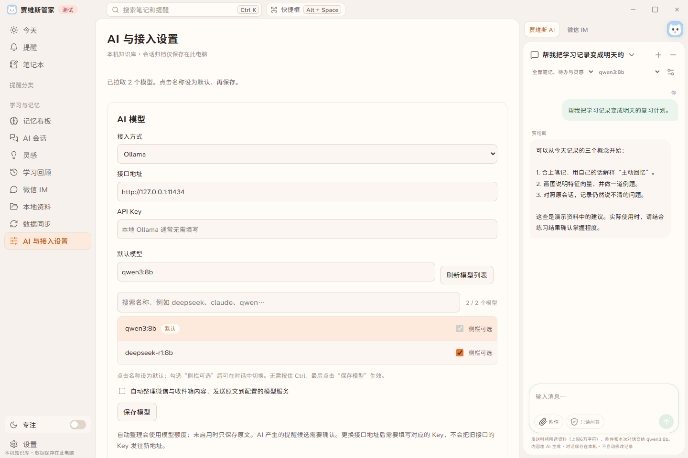](docs/screenshots/model-picker.png) | [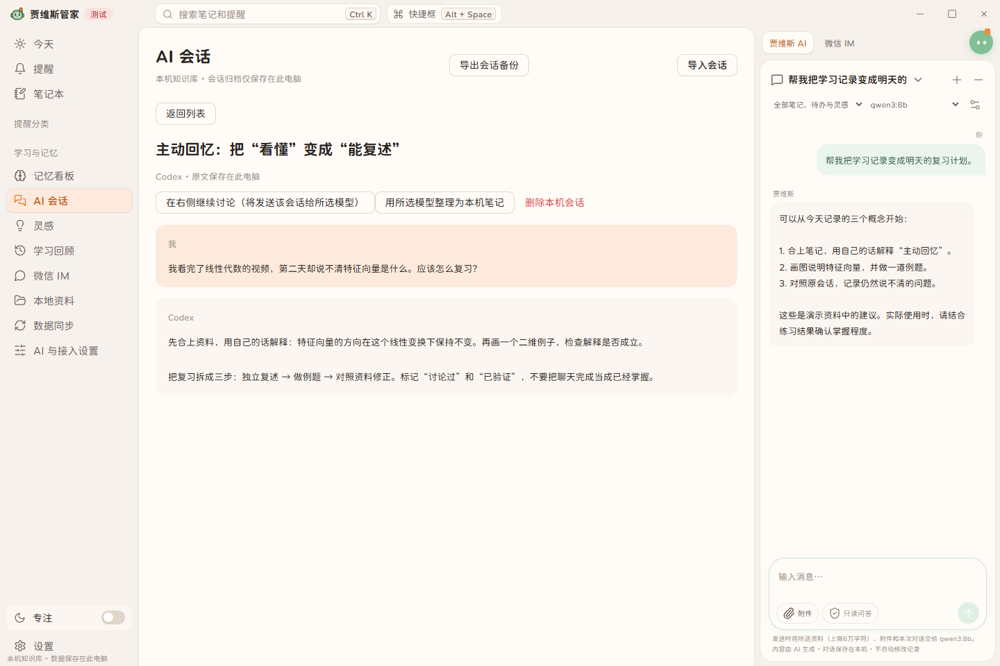](docs/screenshots/conversation-original.png) |
| **每日学习回顾** | **可迁移本地资料** |
| [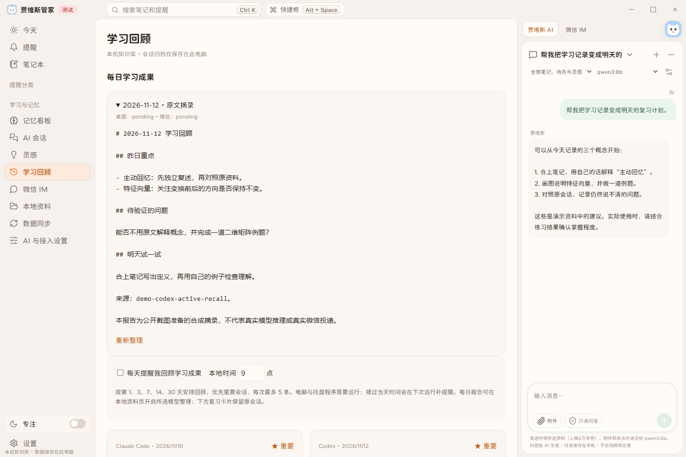](docs/screenshots/learning-review.png) | [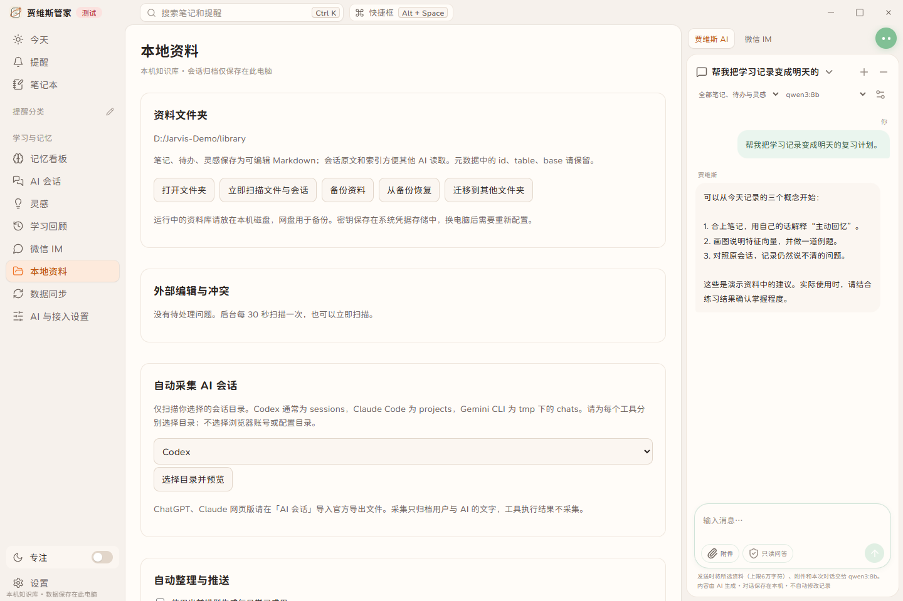](docs/screenshots/local-library.png) |
| **独立数据同步** | **深色主题** |
| [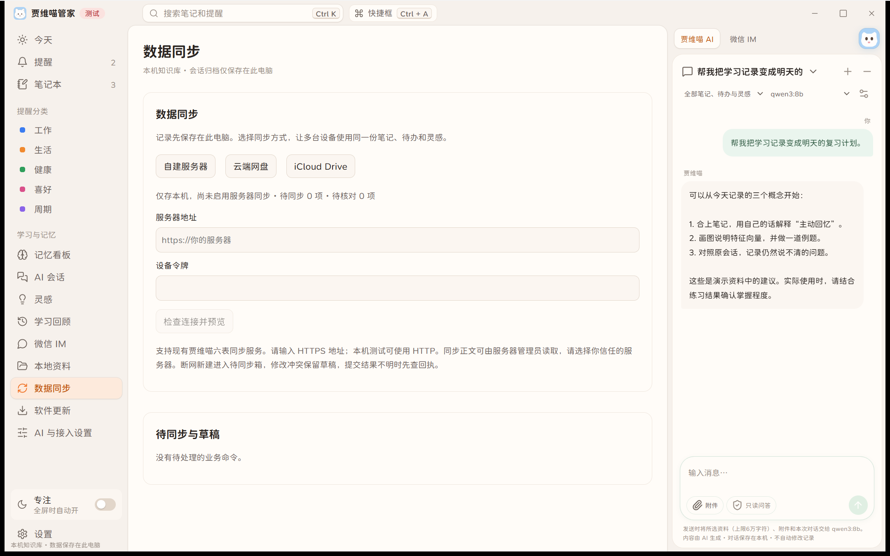](docs/screenshots/data-sync.png) | [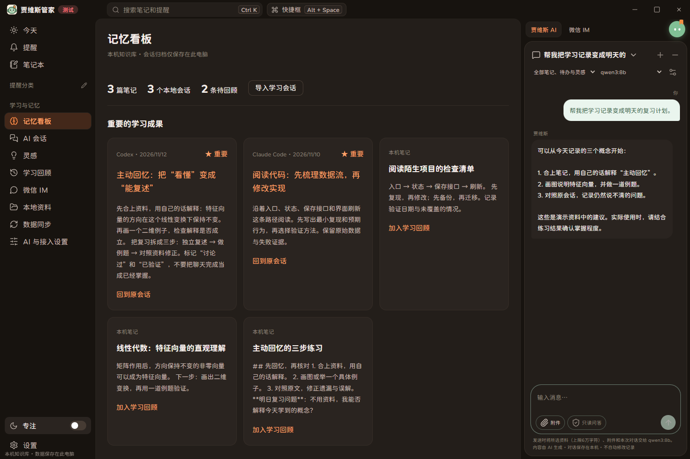](docs/screenshots/memory-dark.png) |

<details>
<summary>Windows 原生窗口、会话列表与微信设置</summary>

Windows 原生 Tauri／WebView2 窗口（0.4.1旧图标历史截图）：独立演示实例，1800×1100。截图保留了真实发生的快捷键占用提示，说明占用时会提示调整；没有使用私人笔记或模型账号。

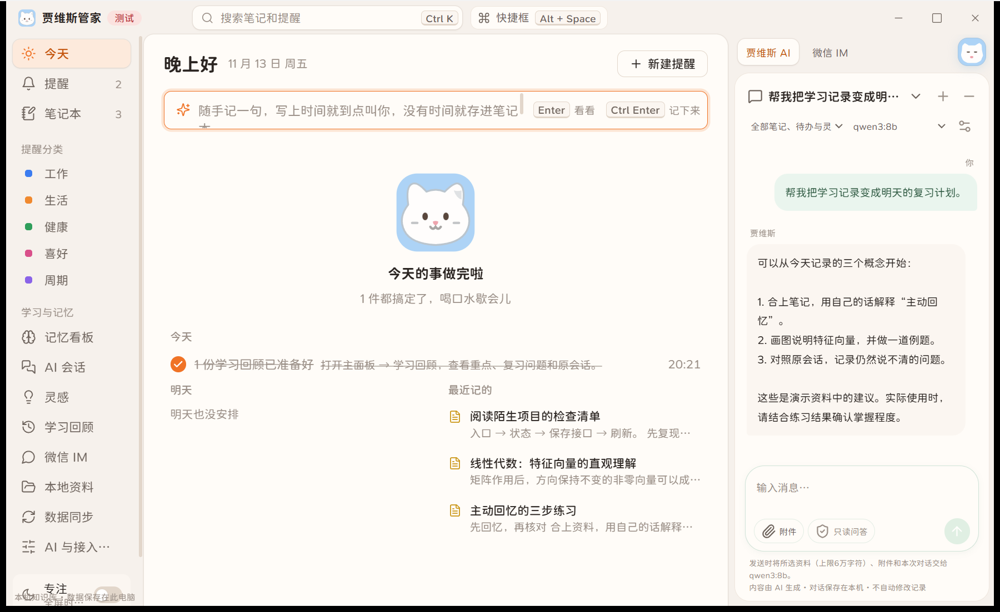

会话列表：

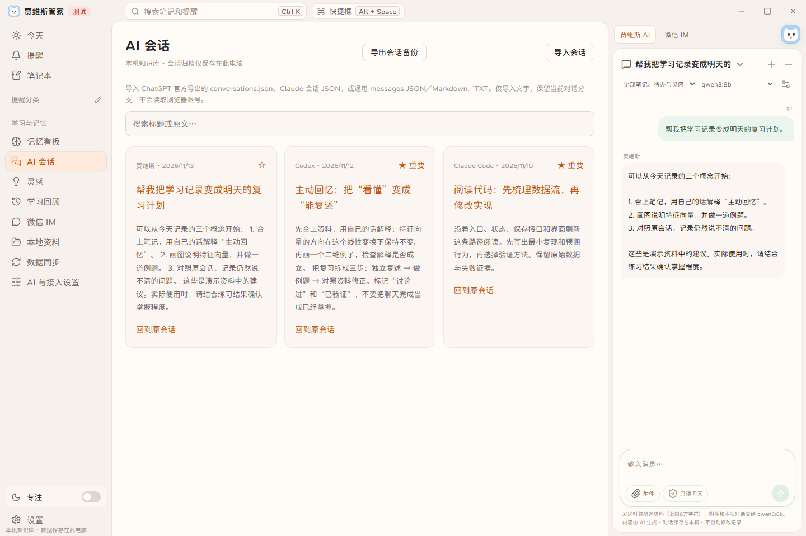

微信配置页保持未绑定／未配对：

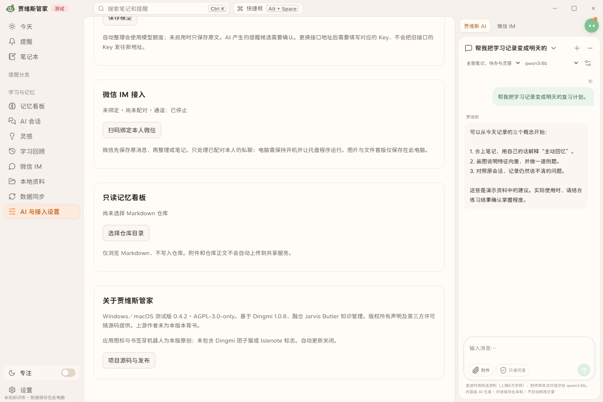

</details>

[全部截图、来源与复现方法](docs/screenshots/README.md)

## 数据、隐私与当前边界

| 项目 | 当前行为 |
| --- | --- |
| 笔记／会话／资料文件 | 本机明文 SQLite／Markdown；不等于已加密 |
| API Key 与微信认证 | Windows 凭据管理器／Mac Keychain，不进入业务导出；换电脑需重新配置 |
| 云端模型 | 会收到本人选择的资料、会话摘录和输入；可能计费。Ollama 可用于本机推理 |
| 服务器同步 | 对接既有 Jarvis 六表 API；不是任意 VPS 或网盘链接。正文对服务器管理员可见 |
| 会话与桌面附件 | 不随六表同步自动跨设备共享 |
| 云盘／iCloud | 保留入口，尚未接通双向同步 |
| 微信 | 本人私聊，受当前 iLink 协议与上下文限制；真实扫码／推送待验收 |
| OCR／语音转写／文章全文抓取 | 不在首版能力中 |
| 完整知识图谱编辑 | 尚未作为本版已完成功能提供 |
| Mac | Apple Silicon 构建与测试通过；未公证，真机体验仍待验收 |

程序内 AI 不拥有终端、任意文件操作或自动执行权限。来源与整理结果可追溯，但模型总结仍需本人核对。

## 构建与验证

Node 24、Rust stable；Windows 需要 MSVC C++ 与 WebView2，Mac 需要 Xcode Command Line Tools。在项目目录执行：

```sh
npm ci
npm test
npm run build
cargo test -p jarvis-workspace -- --test-threads=1
cargo test -p jarvis-desktop --lib -- --test-threads=1
node scripts/licenses.mjs --check
```

Windows：`npx tauri build --ci --bundles nsis`。

Mac：`npx tauri build --ci --target aarch64-apple-darwin --bundles dmg --config apps/desktop/src-tauri/tauri.macos.conf.json`。

本机源码预览：`cargo build -p jarvis-desktop --example fusion-preview --features tauri/custom-protocol` 后双击 `启动贾维喵测试版.cmd`。开发预览与安装版默认数据目录独立，旧资料通过“备份 → 从备份恢复”带入，原目录保留。

0.4.1 记录：前端 605 项、核心 31 项、共享兼容 12 场景、服务器集成 18 场景；Windows 原生库 140 项通过／11 项忽略，Mac 136 项通过／9 项忽略。Windows 安装、卸载与重装保留测试资料已检查；这些结果不代表真实微信、真实模型或 Mac 真机交互已验收。

[完整验证记录](docs/validation-0.4.0.md) · [Mac 构建与验收](docs/MAC_PORTING_PLAN.md) · [发布与已知限制](docs/release-notes.md)

## 来源与许可

整体 **AGPL-3.0-only**，见 [LICENSE](LICENSE)。基于 Dingmi 1.0.8 的授权代码，融合 Jarvis Butler 的 MIT 知识管理部分；保留原作者、字体和其他依赖的版权与许可。

[来源与修改记录](UPSTREAM.md) · [Jarvis MIT 声明](licenses/JARVIS-MIT.txt) · [第三方清单](THIRD_PARTY_LICENSES.md)

本版使用自行生成的白色小猫图标与独立编写的SVG／托盘适配，来源与生成方式见[品牌说明](docs/branding.md)。未使用 Dingmi 受限团子猫、上游宣传截图或 Islenote 提取素材；本页截图由本项目自行拍摄。模型选择交互参考 CC Switch，组件为独立实现。原作者未为本版背书；“贾维喵管家”名称采用不代表商标核验已完成。
