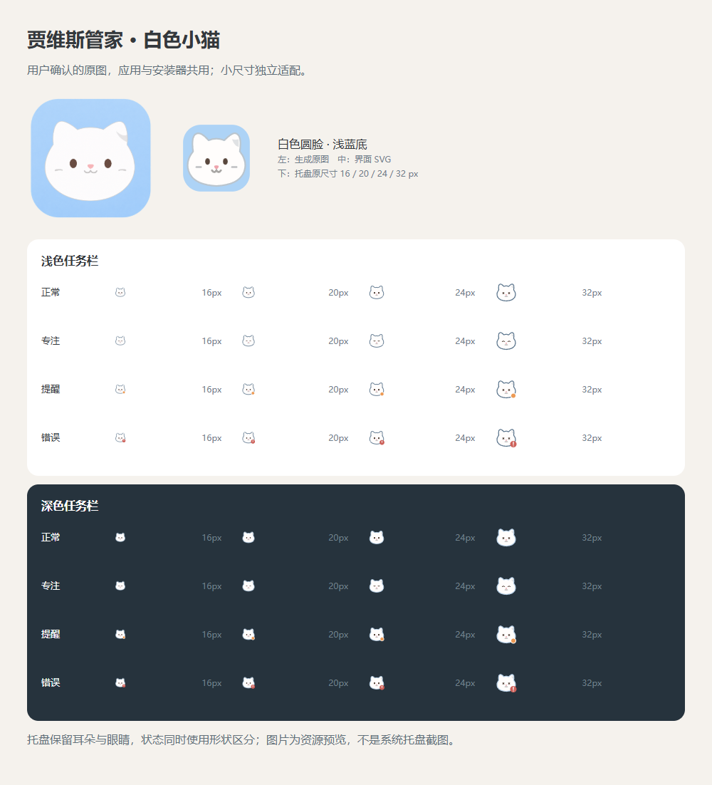

# 贾维喵白色小猫

2026-11-13：用户先选择极简小动物方向，随后要求白色小猫，并在看到候选后明确答复“同意，使用这版”。仅在该确认后应用。先前机器人与小熊候选不用于本版。

形象为浅蓝底、圆脸白猫、小耳朵、深棕色眼睛、粉色鼻子和一侧浅灰耳部细节。图片通过内置 image_gen 生成，没有复制 Dingmi 团子猫、Islenote 或网上角色素材。

- shared/assets/jarvis-kitten-source.png：用户确认的生成原图，原样保存；Windows／Mac 应用与安装器从它派生平台尺寸和格式。
- shared/assets/jarvis-kitten-design.txt：生成工具及设计规格记录。
- shared/mascot.ts：独立编写的同形象 SVG，用于界面及小尺寸托盘；托盘加强轮廓、减少细节。
- scripts/build-icons.mjs：重建应用、安装器、深浅托盘资源以及网页图标。
- 助手入口保留眼神跟随、失焦回正与减少动画；白猫在深色主题中不反相。

图形与适配代码随项目按 AGPL-3.0-only 提供，第三方工具仍遵循各自许可。AI 生成与独立设计不等于商标检索完成或保证没有相似图形。原图与矢量为同一设计的不同尺寸适配，不声称像素一致。

使用内置工具，未调用外部代理；图片生成 token 和费用工具未返回，记为未知。

